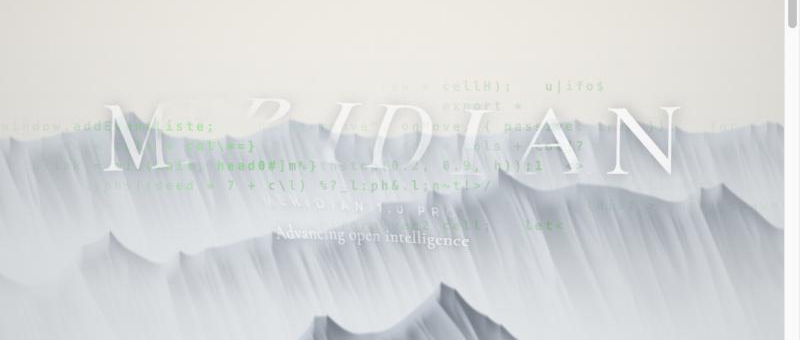

# Scroll Glitch Hero

**[在线演示 / Live demo →](https://codermaurice.github.io/scroll-glitch-hero/)**

[中文](#中文) · [English](#english)





---

## 中文

一个滚动触发的首屏转场动效：往下一滑，雾中山景被撕成一条条横向故障带，代码字符在碎片里一闪而过，画面按方块逐块溶解，下面的正文同时浮上来。滚回顶部，动画倒着播放，山景重新拼合。

灵感来自 Kimi K3.1 Pro 技术报告官网首页的转场效果。这是一个独立的重新实现：山景是程序生成的，着色器和脚本都是从头写的，没有使用原站的任何代码或素材。

### 特点

- **单个 HTML 文件**：没有构建步骤，也没有依赖，双击就能打开
- **程序生成的雾山**：WebGL2 着色器实时绘制，不需要图片素材，鼠标移动有视差
- **鼠标代码轨迹**：鼠标经过的地方，隐藏的代码会一段段淡淡亮起，并像打字一样继续延伸、慢慢淡出，所以鼠标停下来代码也还在动；光标附近的代码会变成更亮的绿色。在深色山体上清晰，在亮云里几乎消失
- **推开标题**：鼠标划过标题时，笔画沿路径像被湿笔刷抹开一样消失，边缘毛糙；周围的字被推向鼠标移动的方向，然后像果冻一样回弹、晃几下复位
- **故障转场**：粗、细两层撕裂带、横向拉丝、RGB 色散、重影，部分撕裂带上印着滚动的代码
- **方块溶解**：画布透明度按块打开，露出下面真实的 DOM 正文（文字可选中，SEO 友好）
- **可逆**：从正文滚回顶部会反向播放
- **降级处理**：开启"减少动态效果"或不支持 WebGL2 时，退回普通的静态滚动

### 使用

在线体验：[https://codermaurice.github.io/scroll-glitch-hero/](https://codermaurice.github.io/scroll-glitch-hero/)（建议用电脑打开，往下滚一下；滚回顶部会反向播放）

本地运行：

```bash
git clone https://github.com/CoderMaurice/scroll-glitch-hero.git
cd scroll-glitch-hero
open index.html
```

也可以起一个本地服务器：`python3 -m http.server`，然后访问 `http://localhost:8000`。

### 自定义

`index.html` 脚本开头的 `CONFIG`：

| 字段 | 说明 |
| --- | --- |
| `title` / `subtitle` / `tagline` | 首屏文字 |
| `duration` | 转场时长（毫秒），默认 900 |
| `cooldown` | 转场结束后锁定输入的时长（毫秒） |
| `glitchAmount` | 撕裂强度，0–1 |
| `codeReach` | 光标周围代码变亮的半径（px） |
| `titleVeil` | 标题上薄雾的浓度，0–1 |

故障条里出现的代码在 `CODE` 数组里。在网址后面加 `?slow=10`，转场会慢放 10 倍，方便逐帧观察。

### 原理

1. **滚动锁定**：页面滚动超过 8px 时开始一段固定时长的时间线（进度 0→1），期间拦截滚轮、触摸和方向键，把滚动位置钉住。结束后跳到正文顶部。
2. **两个渲染通道**：第一个通道把雾山画进一张低分辨率离屏纹理；第二个通道叠上标题，再做故障处理，直接输出到屏幕。
3. **撕裂带**：每一行切成宽度随机的格子，由一层低频噪声决定哪些区域"活跃"，活跃格子做水平位移、拉丝和色散。
4. **溶解**：输出的 alpha 按方块逐渐变为 0，大致从底部开始、成片打开。因为用的是预乘 alpha，透明处直接露出下面的 HTML。
5. **正文入场**：通过 CSS 变量 `--reveal` 驱动正文的淡入和上移。
6. **代码轨迹**：屏幕划成等宽字符格，预先把整面代码墙画进一张纹理（R 通道是代码，G 通道是乱码）。鼠标路径上、以及鼠标静止时光标周围，会持续生成若干段代码，每段有头部、长度、速度和寿命。CPU 每帧把它们写进一张很小的 RG8 网格纹理，着色器按格子取代码墙，离光标越近颜色越亮。
7. **推开标题**：一张粗网格（RGBA16F）上的每个格子是一个带阻尼的弹簧，并和相邻格子耦合。鼠标沿移动方向推动格子，推力像涟漪一样扩散，过冲后回弹，标题按这个位移采样。同一张纹理还有一个“湿笔刷”通道，标记鼠标划过的路径，加上纤维噪声就把字抹出毛边；不到一秒干掉后，字就回来了。

### 许可

[MIT](LICENSE)

本项目与 Kimi / Moonshot AI 没有任何关联。

---

## English

A scroll-triggered hero transition. Scroll down once and the misty mountain scene tears apart into horizontal glitch bands, with flashes of source code inside the fragments. The frame then dissolves block by block while the article underneath rises into view. Scroll back to the top and it plays in reverse, reassembling the scene.

Inspired by the hero transition on the Kimi K3.1 Pro tech-report page. This is an independent re-implementation: the scenery is procedural, and the shaders and script are written from scratch. No code or assets from the original site are used.

### Features

- **Single HTML file**: no build step and no dependencies, just open it
- **Procedural misty mountains**: drawn live by a WebGL2 shader with no image assets, plus pointer parallax
- **Cursor code trails**: wherever the mouse passes, hidden code lights up faintly in short runs that keep typing onward and fade over several seconds, so the code is still moving after the pointer stops. Code near the cursor glows a brighter green. It reads over dark rock and melts away into bright cloud
- **Pushing the title**: as the mouse crosses the title, a wet brush-like stroke wipes the lettering away along its path with ragged edges, while nearby letters get shoved in the direction of travel, then spring back with a jelly-like wobble
- **Glitch transition**: two layers of tears (fine and coarse), horizontal smears, RGB split and ghosting, with scrolling code printed on some of the tears
- **Block dissolve**: canvas alpha opens in blocks to reveal the real DOM article underneath (selectable text, SEO-friendly)
- **Reversible**: scrolling back up from the article plays the transition backwards
- **Graceful fallback**: with `prefers-reduced-motion` or without WebGL2 it falls back to a plain static page

### Usage

Try it online: [https://codermaurice.github.io/scroll-glitch-hero/](https://codermaurice.github.io/scroll-glitch-hero/). A desktop browser works best: scroll down once, then scroll back to the top to see it reverse.

Run locally:

```bash
git clone https://github.com/CoderMaurice/scroll-glitch-hero.git
cd scroll-glitch-hero
open index.html
```

Or serve it locally with `python3 -m http.server` and visit `http://localhost:8000`.

### Customize

`CONFIG` at the top of the script in `index.html`:

| Key | Description |
| --- | --- |
| `title` / `subtitle` / `tagline` | Hero text |
| `duration` | Transition length in ms (default 900) |
| `cooldown` | How long input stays locked after the transition, in ms |
| `glitchAmount` | Tear intensity, 0–1 |
| `codeReach` | Radius around the pointer where code glows brighter (px) |
| `titleVeil` | How much drifting mist covers the title, 0–1 |

The code shown inside the tears lives in the `CODE` array. Append `?slow=10` to the URL to play the transition 10× slower and inspect it frame by frame.

### How it works

1. **Scroll lock**: once the page scrolls past 8px, a fixed-length timeline starts (progress 0→1). While it runs, wheel, touch and arrow-key input are intercepted and the scroll position is pinned. When it ends, the page jumps to the top of the article.
2. **Two render passes**: the first pass draws the mountains into a low-resolution offscreen texture. The second composites the title, applies the glitch and outputs straight to the screen.
3. **Tears**: each row is split into cells of random width. A low-frequency noise field decides which areas are active, and active cells get shifted, smeared and colour-split.
4. **Dissolve**: output alpha falls to zero block by block, in ragged patches that roughly start from the bottom. Premultiplied alpha lets the HTML below show through.
5. **Article entrance**: a CSS variable, `--reveal`, drives the article's fade and rise.
6. **Code trails**: the screen is a monospace cell grid, and a full wall of code is pre-rendered into one texture (code in red, scramble glyphs in green). Runs keep spawning along the pointer's path and, while it rests, around it; each has a head, length, speed and lifetime. Every frame the CPU writes them into a tiny RG8 grid texture, and the shader reads the wall per cell, glowing brighter near the pointer.
7. **Pushing the title**: each cell of a coarse RGBA16F grid is a damped spring coupled to its neighbours. The pointer shoves cells along its direction of travel, and the shove ripples outward, overshoots and settles. The title is sampled through that displacement. A second "wet brush" channel marks the pointer's path; with fibre noise it wipes the letters away with ragged edges, and they return once it dries out in under a second.

### License

[MIT](LICENSE)

Not affiliated with Kimi or Moonshot AI.
